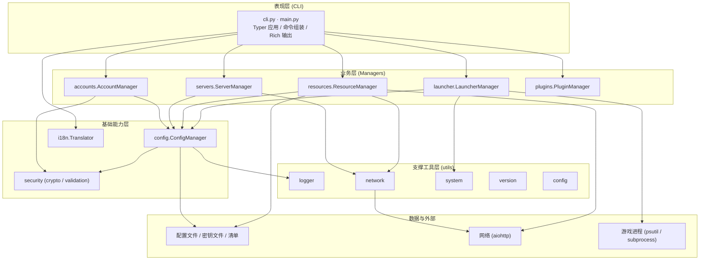
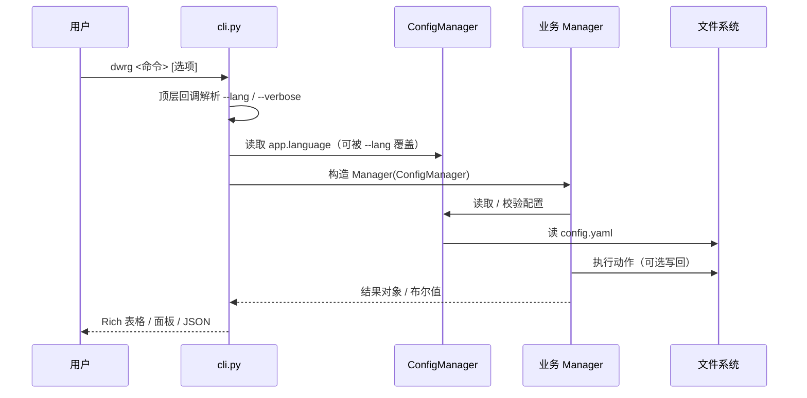
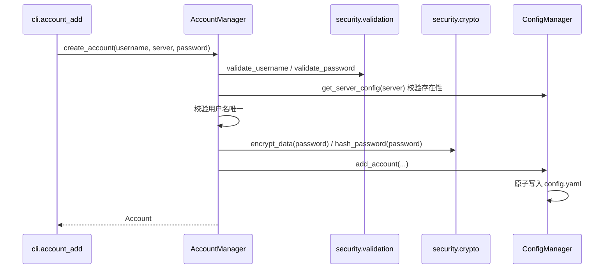
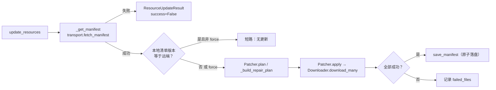

# 架构设计

本页说明 `dwrg` 的分层架构、模块职责、关键数据流与设计决策。

## 一、分层架构



约定：

- **表现层**只做参数解析、编排与展示，不承载业务规则。
- **业务层**由各 `Manager` 组成，统一经 `ConfigManager` 读写持久化数据，不直接操作文件系统（`ResourceManager` 因资源落盘需求例外）。
- **基础能力层**收敛配置、国际化与安全三类横切能力。
- **支撑工具层**提供无业务语义的通用函数，全部做了降级处理。

## 二、模块职责

| 模块 | 文件 | 职责 |
|------|------|------|
| 包入口 | `__init__.py` | 版本 / 作者元数据；`get_app()` 惰性导入 Typer 应用 |
| 主入口 | `main.py` | 控制台脚本入口，转发 `cli.app` |
| CLI | `cli.py` | Typer 应用与全部命令的**唯一定义处**，含错误转换与输出格式化 |
| 异常 | `exceptions.py` | `DWRGError` 体系，统一 `user_message()` |
| 配置模型 | `config/models.py` | 配置领域**唯一**数据模型：`Config` / `AppConfig` / `ServerConfig` / `AccountConfig` 及常量 |
| 配置管理器 | `config/manager.py` | 加载 / 原子保存 / CRUD / 导入导出 / 应用级键设置 |
| 账号 | `accounts/manager.py`、`models.py` | 账号 CRUD、切换、登录、密码加解密与校验；`Account` / `LoginResult` 运行时模型 |
| 渠道服 | `servers/manager.py`、`models.py`、`detection.py` | 渠道服同步 CRUD 与异步探测；`ServerStatus` / `ServerManagerConfig`；`detection` 为向后兼容再导出层 |
| 资源 | `resources/manager.py`、`downloader.py`、`validator.py`、`patcher.py`、`models.py` | 编排校验 / 下载 / 补丁；下载器支持并发、退避重试、断点续传 |
| 启动 | `launcher/manager.py`、`models.py` | 路径解析、命令组装、进程启动 / 停止 / 状态、诊断 |
| 插件 | `plugins/base.py`、`manager.py`、`models.py` | `Plugin` 基类与上下文协议、动态加载与启用状态持久化 |
| 国际化 | `i18n/translator.py`、`datetime_utils.py`、`locales/` | 点号键翻译与回退链；日期 / 时长 / 相对时间本地化 |
| 安全 | `security/crypto.py`、`validation.py` | 密钥管理、对称加解密、密码哈希；业务输入校验 |
| 工具 | `utils/logger.py`、`network.py`、`system.py`、`version.py`、`config.py` | 日志、异步 HTTP（渠道服探测）、系统信息、版本号、轻量 YAML 读写；`utils/crypto.py` / `utils/security.py` 为再导出层 |

## 三、关键数据流

### 1. 命令执行总流程



### 2. 账号创建流程



### 3. 资源更新流程



## 四、关键设计决策

### 1. 唯一数据模型来源

`ServerConfig` 的定义**只**存在于 `config/models.py`；`servers/models.py` 仅做再导出。这消除了早期「同一概念两份字段定义」的结构性隐患。

```python
# servers/models.py
from ..config.models import ServerConfig
__all__ = ["ServerConfig", "ServerManagerConfig", "ServerStatus"]
```

同理，版本号唯一来源是包根 `__version__`，`utils/version.py` 只做惰性转发。

### 2. security 包收敛加密能力

加密与校验实现**只**存在于 `dwrg_manager.security`：

- `security.crypto` —— 密钥、对称加解密、密码哈希；
- `security.validation` —— 用户名 / 密码 / 账号 ID / 渠道服 / 版本号 / 语言 / 路径校验。

`utils/crypto.py` 与 `utils/security.py` 保留为**向后兼容再导出层**，新代码应直接 `from dwrg_manager.security import ...`。

### 3. 原子写入

配置与本地清单均采用「同目录临时文件 + 原子替换」：

| 对象 | 实现 |
|------|------|
| 配置文件 | `tempfile.mkstemp` 写入同目录，成功后 `os.replace` |
| 本地清单 | 写 `<name>.tmp` 后 `Path.replace` |
| 单文件下载 | 写 `<name>.part`，成功后 `os.replace` 到目标 |

任何一步失败都会清理临时文件，保证目标文件要么是完整的旧版本、要么是完整的新版本。

### 4. DWRGError 异常体系

所有对外异常派生自 `DWRGError`（`exceptions.py`），每类携带面向用户的中文前缀，并通过 `user_message()` 生成单行提示：

| 异常 | 前缀 | 典型归属 |
|------|------|----------|
| `DWRGError` | `错误` | 基类 |
| `ConfigError` | `配置错误` | 配置读写与取值 |
| `AccountError` | `账号错误` | 账号业务 |
| `ServerError` | `渠道服错误` | 渠道服业务与网络探测 |
| `ResourceError` | `资源错误` | 资源下载与校验 |
| `LaunchError` | `启动错误` | 启动与进程管理 |
| `PluginError` | `插件错误` | 插件加载与执行 |
| `SecurityError` | `安全错误` | 加密、密钥、权限 |
| `ValidationError` | `参数错误` | 输入校验（可附带 `field`） |

CLI 层通过 `_cli_errors(action)` 上下文管理器统一捕获，转换为 `✗ <动作><失败>: <user_message>` 并返回退出码 1；`KeyboardInterrupt` 转换为退出码 130。底层异常（`sqlite3` / `requests` 等）不会直接暴露给用户。

### 5. 优雅降级优先

面向「诊断类」与「网络类」命令，设计上优先返回可读结果而非抛异常：

| 位置 | 降级行为 |
|------|----------|
| `ServerManager.probe_server` | 探测失败标记 `offline`、`ping=inf`，不抛出 |
| `ServerManager.probe_all` | 单个任务异常被 `return_exceptions=True` 隔离 |
| `ResourceManager._get_manifest` | 传输层异常统一降级为 `None` |
| `ResourceManager.get_cache_info` | 读取异常返回 `{}` |
| `SystemManager.*` | 权限不足返回空结果并记日志 |
| `Translator._read_catalog_file` | 目录缺失 / 损坏降级为空字典 |
| `PluginManager.discover` | 单个非法插件被跳过，不影响其它插件 |

### 6. 异步边界

异步仅用于 I/O 密集场景（渠道服探测、资源下载、清单获取），并且：

- CLI 在同步函数中用 `asyncio.run(...)` 桥接异步 Manager；
- 磁盘写入与哈希计算通过 `asyncio.to_thread` 下放到线程，避免阻塞事件循环；
- 测试可通过注入 `session_factory` / `transport` 完全避开真实网络。
