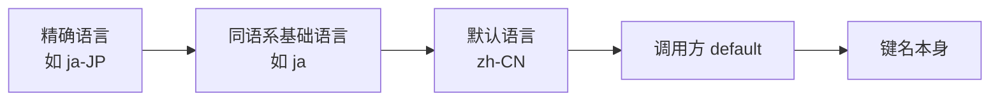

# 国际化

国际化为 `dwrg` 提供多语言文案与日期时间本地化，实现位于 `dwrg_manager.i18n`。

## 一、语言切换

### 1. 三种切换方式

| 方式 | 命令 / 配置 | 生效范围 |
|------|-------------|----------|
| 全局选项 | `dwrg --lang en-US <命令>` | 仅本次调用 |
| 配置项 | `dwrg config set language en-US` | 持久化，之后所有命令 |
| 进程内 API | `set_language("en-US")` | 当前 Python 进程 |

优先级：`--lang` > 配置中的 `app.language`。若 `--lang` 不被支持，顶层回调会捕获 `DWRGError`、记录警告「语言初始化失败，回退默认」并保持翻译器的默认语言（`zh-CN`），命令本身仍可继续执行。

### 2. 受支持语言

```text
zh-CN  zh-TW  en-US  ja-JP  ko-KR  fr-FR  de-DE  es-ES  ru-RU
```

常量 `SUPPORTED_LANGUAGES` 定义于 `config.models`，是语言合法性的唯一来源。传入不受支持的语言会抛出：

```text
参数错误: 不支持的语言: xx-XX
```

> 仓库当前实际提供目录文件的只有 `zh-CN.json` 与 `en-US.json`；其余语言代码合法，但会沿回退链落到 `zh-CN` 文案。

## 二、locale 目录结构

### 1. 文件位置与命名

```text
src/dwrg_manager/i18n/
└── locales/
    ├── zh-CN.json
    └── en-US.json
```

文件名即语言代码，扩展名固定为 `.json`。翻译器按需惰性加载并缓存，缺失或损坏一律降级为空字典。

### 2. 键值格式：扁平点号键

```json
{
  "cli.app.help": "第五人格游戏多渠道服和多账号管理工具",
  "cli.account.add.success": "账号添加成功: {username}"
}
```

规则：

- 键为**扁平点号字符串**（不嵌套）；
- 值为字符串；
- 非字符串键值会被忽略并记录警告；
- 顶层必须是对象，否则整个目录降级为空。

### 3. 键命名约定

| 前缀 | 用途 | 示例 |
|------|------|------|
| `cli.app.*` | 应用级文案 | `cli.app.help` |
| `cli.group.*` | 命令组描述 | `cli.group.account` |
| `cli.common.*` | 通用文案 | `cli.common.cancelled` |
| `cli.<域>.*` | 各命令域 | `cli.account.add.success` |
| `cli.system.*` | 系统命令 | `cli.system.version` |

## 三、`t()` 用法

### 1. 函数签名

```python
from dwrg_manager.i18n import t, set_language, get_translator

t(key: str, default: str | None = None, **kwargs) -> str
```

| 参数 | 说明 |
|------|------|
| `key` | 扁平点号键 |
| `default` | 目录未命中时的兜底文案；`None` 时回退为键名本身 |
| `**kwargs` | 传给 `str.format` 的占位符参数 |

### 2. 示例

```python
from dwrg_manager.i18n import t, set_language

set_language("zh-CN")
assert t("cli.app.help") == "第五人格游戏多渠道服和多账号管理工具"
assert t("cli.account.add.success", username="tester") == "账号添加成功: tester"

set_language("en-US")
assert t("cli.app.help") == "Manage multiple channels and accounts for Identity V"

# 未命中的键回退
assert t("no.such.key", default="兜底") == "兜底"
assert t("no.such.key") == "no.such.key"
```

CLI 命令内部即通过该函数输出面向用户的文案：

```python
# cli.py 片段
rprint(
    f"[red]✗[/red] {action}{t('cli.common.failed_suffix', default='失败')}: {exc.user_message()}"
)
```

### 3. 回退链

查找顺序（去重且保序）：



- `zh-TW` 特判回退到 `zh-CN`（繁体 → 简体目录）；
- 其余区域语言（如 `ja-JP`）先尝试基础形态（`ja`）；
- 任何一步缺失都不抛异常，保证界面至少显示键名。

### 4. 占位符容错

`t()` 在格式化失败（缺参数、索引越界等）时**返回未格式化的原文**并记录 `debug` 日志，不抛异常：

```python
t("cli.account.add.success")  # → "账号添加成功: {username}"
```

### 5. 相关 API

| 函数 / 属性 | 说明 |
|-------------|------|
| `Translator(language, catalog_dir=None)` | 构造翻译器；`catalog_dir` 默认本包 `locales/` |
| `Translator.language` | 当前语言 |
| `Translator.available_languages` | 全部受支持语言（= `SUPPORTED_LANGUAGES`） |
| `Translator.load_catalog(language)` | 加载 / 缓存某语言目录 |
| `Translator.has(key)` | 键是否可在回退链中解析 |
| `Translator.t(key, default, **kw)` | 实例方法版翻译 |
| `get_translator()` | 获取进程级单例 |
| `set_language(language)` | 切换单例语言 |
| `t(key, default, **kw)` | 使用单例翻译 |

## 四、新增语言步骤

以新增 `ja-JP` 为例：

（1）在 `src/dwrg_manager/i18n/locales/` 下创建 `ja-JP.json`；

（2）复制 `zh-CN.json` 的全部键，逐条翻译（不建议删键，缺失的键会走回退链，但仍建议补全）：

```json
{
  "cli.app.help": "Identity V の多チャンネル・多アカウント管理ツール",
  "cli.common.cancelled": "キャンセル済み"
}
```

（3）确认语言代码已在 `SUPPORTED_LANGUAGES` 中（`ja-JP` 已在内，无需改动；若为全新语言，需在 `config/models.py` 追加并同步 `security.validation` 的可用列表提示）；

（4）验证：

```bash
dwrg --lang ja-JP help
```

（5）如无需回退到 `zh-CN`，确保目录覆盖了命令行实际引用的键（可对照 `cli.py` 中的 `t(...)` 调用与现有目录文件）。

## 五、日期时间本地化

`i18n/datetime_utils.py` **只依赖标准库**：中文（`zh-*`）走中文命名格式，其余语言走英文 12 小时制，二者输出明显不同。

### 1. 格式化函数

| 函数 | 签名 | 说明 |
|------|------|------|
| `format_datetime` | `(value, fmt="medium", language=None)` | `fmt` ∈ `short` / `medium` / `long` / `iso`；非法值退回 `medium` |
| `format_date` | `(value, language=None)` | 仅日期 |
| `format_time` | `(value, language=None)` | 仅时间，含秒 |
| `format_duration` | `(seconds)` | 时长；负数按 0 处理 |
| `format_relative_time` | `(value, now=None)` | 相对时间；`now` 缺省为当前时间 |

`language=None` 时读取全局翻译器 `get_translator().language`。`format_duration` 与 `format_relative_time` **不接受** `language` 参数，始终读取当前语言。

### 2. 输出示例

| 调用 | 中文（`zh-CN`） | 英文（`en-US`） |
|------|-----------------|-----------------|
| `format_datetime(v)` | `2026年10月03日 19:45` | `Oct 3, 2026 7:45 PM` |
| `format_datetime(v, "short")` | `2026-10-03 19:45` | `10/3/2026 7:45 PM` |
| `format_datetime(v, "long")` | `2026年10月03日 19:45:30` | `October 3, 2026 7:45:30 PM` |
| `format_datetime(v, "iso")` | `2026-10-03T19:45:00` | 同左 |
| `format_date(d)` | `2026年10月03日` | `Oct 3, 2026` |
| `format_time(v)` | `19:45:30` | `7:45:30 PM` |
| `format_duration(3723)` | `1小时2分3秒` | `1h 2m 3s` |
| `format_relative_time(v, now)` | `3分钟前` | `3 minutes ago` |

相对时间分级：`<10 秒`（过去）→ `刚刚` / `just now`；此后按秒 / 分 / 时 / 天 / 月 / 年逐级取整（月按 30 天、年按 365 天估算）。未来时间使用「后」/ `in ...`。
