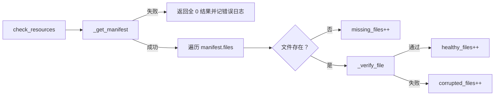
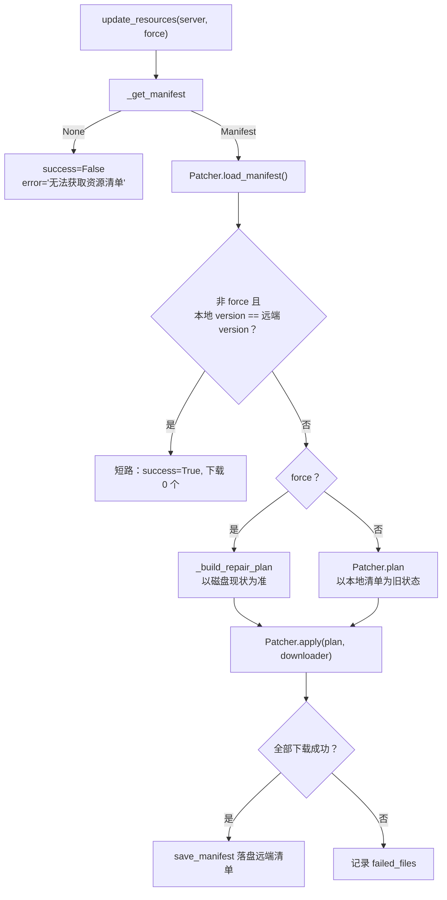
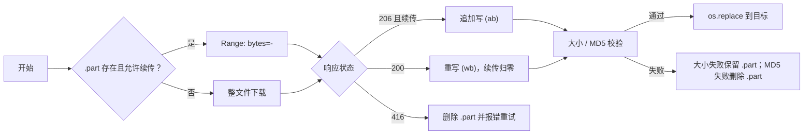

# 资源管理

资源管理负责游戏文件的完整性检查、增量更新与缓存维护，实现位于 `dwrg_manager.resources`。

## 一、总体组成

| 组件 | 文件 | 职责 |
|------|------|------|
| `ResourceManager` | `manager.py` | 编排：选择服务器、获取清单、调用校验 / 补丁、缓存统计与清理 |
| `Downloader` | `downloader.py` | 并发下载、退避重试、断点续传、原子落盘 |
| `Validator` | `validator.py` | 分块流式哈希、全量校验、抽样快速校验、体积格式化 |
| `Patcher` | `patcher.py` | 清单比对、下载编排、失效文件删除、本地清单落盘 |
| 数据模型 | `models.py` | 清单 / 文件 / 任务 / 结果 / 计划等结构体 |

`ResourceManager` 只做「装配」，真正的下载 / 校验 / 比对逻辑分别在三个子模块。

## 二、目录与文件

| 路径 | 说明 |
|------|------|
| `data_dir` | 数据根目录，来自 `app.data_dir`（默认 `~/.dwrg`） |
| `data_dir/game` | 游戏资源根目录（`game_dir`），清单文件按 `path` 落在此处 |
| `cache_dir` | 缓存目录，来自 `app.cache_dir`（默认 `~/.dwrg/cache`） |
| `data_dir/manifest.json` | 本地已记录的资源清单（由 `Patcher` 读写） |

三个目录在 `ResourceManager` 初始化时自动创建。

### 资源服务器

`ResourceManager` 内置两个资源服务器（与渠道服配置是**两套独立概念**）：

| 名称 | 地址 |
|------|------|
| `official` | `https://resources.identityv.com`（`base_url` 为 `.../v1`） |
| `backup` | `https://backup.resources.identityv.com`（`base_url` 为 `.../v1`） |

`--server` 选项用于选择资源服务器名称；省略时使用第一个（`official`）。清单从 `<base_url>/manifest.json` 拉取。

## 三、清单结构

### 1. `ResourceManifest`

| 字段 | 类型 | 说明 |
|------|------|------|
| `version` | `str` | 清单版本 |
| `files` | `list[ResourceFile]` | 文件列表 |
| `total_size` | `int` | 总大小 |
| `created_at` | `datetime` | 创建时间 |
| `download_url` | `str` | 下载基础 URL |

### 2. `ResourceFile`

| 字段 | 类型 | 说明 |
|------|------|------|
| `name` | `str` | 文件名（用于拼接下载 URL） |
| `path` | `str` | 相对路径（文件身份标识与落盘位置） |
| `size` | `int` | 大小（字节） |
| `md5` | `str` | 整文件 MD5 |
| `version` | `str` | 所属版本 |
| `is_optional` | `bool` | 是否可选 |
| `last_modified` | `datetime` | 最后修改时间 |
| `partial_hash` | `str \| null` | 抽样哈希，可选；缺失时只能全量校验 |
| `sha256` | `str \| null` | 整文件 SHA256，可选 |

## 四、检查流程 `resource check` / `resource verify`



`_verify_file` 的判定顺序：

（1）文件不存在 → 失败；
（2）若清单提供 `partial_hash` 且 `Validator.quick_check` 通过 → **直接判定通过**；
（3）否则回退 `Validator.verify(path, size, md5, sha256)` 做全量校验。

输出为面板：

```text
资源检查结果
 文件总数: ...
 正常文件: ...
 损坏文件: ...
 缺失文件: ...
```

## 五、校验器 `Validator`

| 方法 | 说明 |
|------|------|
| `hash_file(path, algorithm="md5")` | 分块流式哈希（块 1 MiB），返回十六进制小写串 |
| `sample_hash(path, sample_size=1024)` | 抽样哈希：头 `sample_size` 字节 + 尾 `sample_size` 字节（文件 ≤ `sample_size` 时只取头部） |
| `verify(path, *, size=None, md5=None, sha256=None)` | 全量校验；任一条件不符或读取失败返回 `False` |
| `quick_check(path, size, partial_hash=None)` | 快速校验：仅在「大小一致」且「提供了抽样哈希」时比较；否则返回 `False` 提示回退全量 |
| `human_size(num_bytes)` | 格式化体积（1024 进制，保留两位小数，如 `1.23 MB`） |

所有校验方法**失败只记日志并返回 `False`，不抛异常**。

## 六、更新流程 `resource update`



### 1. 增量计划 `Patcher.plan`

以 `path` 为文件身份，对比本地清单与远端清单：

| 分类 | 判定 |
|------|------|
| `added`（新增） | 本地清单无该 `path` |
| `updated`（更新） | 大小或 MD5 与本地记录不同 |
| `unchanged`（未变化） | 大小与 MD5 均一致 |
| `removed`（删除） | 本地有、远端不再包含 |

### 2. 修复计划 `_build_repair_plan`（`--force`）

忽略「版本是否变化」的短路，直接以**文件系统**为准：缺失进 `added`、校验不通过进 `updated`、通过进 `unchanged`；`removed` 依据本地清单中远端不再包含的文件。

### 3. `Patcher.apply`

- 下载任务 URL = `<download_url>/<file.name>`；
- 全部下载成功（`not failed_files`）才落盘远端清单，保证清单与文件一致；
- 删除 `plan.removed` 中的失效文件；
- 返回 `PatchResult`：`success` / `added` / `updated` / `removed` / `failed_files` / `results` / `error` / `elapsed_time`。

### 4. 更新结果

`resource update` 成功时输出：

```text
✓ 资源更新完成：下载 <N> 个文件
```

`downloaded_files = added + updated`。

## 七、下载器 `Downloader`

### 1. 参数

| 参数 | 默认 | 来源 |
|------|------|------|
| `concurrency` | `5` | `app.max_concurrent_downloads`（1–10） |
| `timeout` | `300` | `app.download_timeout`（5–3600 秒） |
| `retries` | `3` | 单个文件最大尝试次数 |
| `chunk_size` | `65536`（64 KiB） | 流式读写块大小 |
| `retry_backoff` | `0.5` | 指数退避基数（秒） |

### 2. 并发模型

- 使用 `asyncio.Semaphore(concurrency)` 限制同时在下载的文件数；
- `download_many(tasks)` 对任务列表 `asyncio.gather`，返回顺序与输入一致；
- 支持 `on_progress` 回调，每完成一个文件调用一次。

### 3. 断点续传



要点：

- 临时文件为 `<目标名>.part`；
- 服务器不支持 Range（返回 200）时回退整文件重下；
- **大小校验失败时保留 `.part`**，以便下次继续续传；**MD5 校验失败时删除 `.part`**，避免脏数据；
- 重试等待为 `retry_backoff * 2 ** (attempt - 1)`（0.5、1、2 秒…）；
- 所有磁盘写入与哈希计算通过 `asyncio.to_thread` 在子线程执行，避免阻塞事件循环；
- 单个文件最终失败**不抛异常**，而是返回 `success=False` 且带 `error`。

## 八、缓存清理与统计

### 1. `resource clean`

| 选项 | 行为 |
|------|------|
| 无 | 仅删除 `cache_dir` 与 `game_dir` 下的 `*.tmp` / `*.part` 临时文件 |
| `--all` / `-a` | 删除整个 `cache_dir` 后重建（不动 `game_dir`） |

### 2. `resource info`

`get_cache_info()` 返回：

| 键 | 说明 |
|----|------|
| `cache_dir` / `game_dir` | 目录路径 |
| `cache_size` / `game_size` | 字节数 |
| `cache_size_human` / `game_size_human` | 人类可读体积 |
| `cache_files` / `game_files` | 文件数量 |

读取异常时返回 `{}`（命令会以默认值渲染表格）。

## 九、离线与容错

| 场景 | 表现 |
|------|------|
| 无法获取清单 | `check` 返回全 0；`update` 返回 `success=False`，`error` 指明原因 |
| 服务器名称不存在 | `_select_server` 记录错误并返回 `None`，进而降级 |
| 传输层异常 | 统一降级为 `None` |
| 单文件下载失败 | 计入 `failed_files`，清单不落盘 |

> 鉴于 `resources.identityv.com` 等地址在离线环境不可达，资源类命令在离线时通常表现为「检查结果全 0 / 更新失败」，属预期行为。
